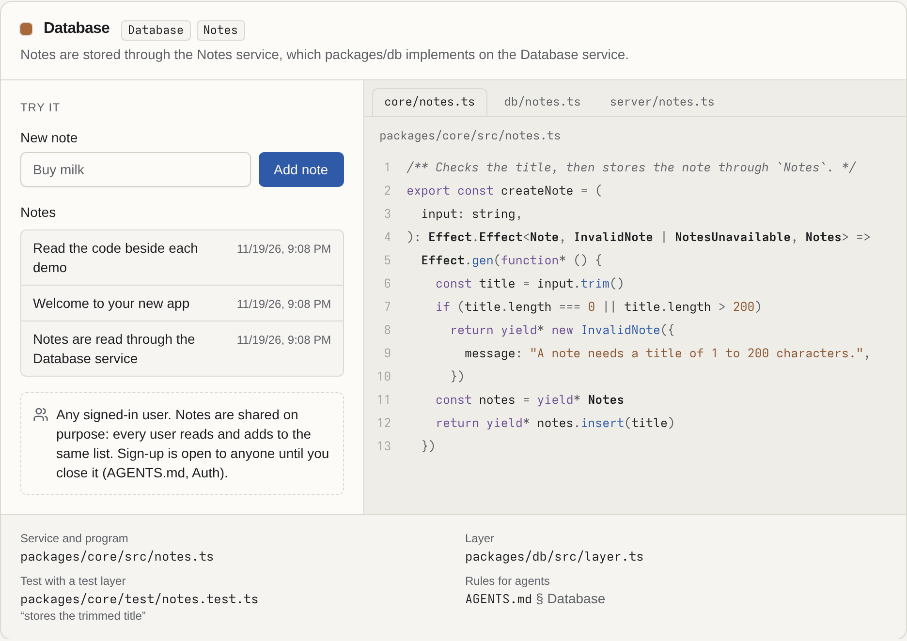
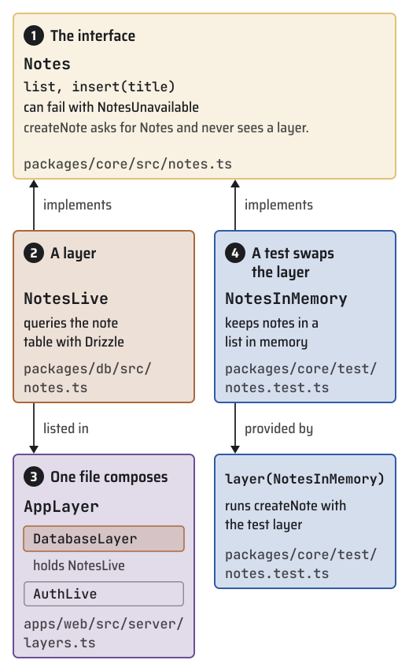

<!-- generated: header (pnpm brand) -->
<h1 align="center">
  <picture>
    <source media="(prefers-color-scheme: dark)" srcset="https://raw.githubusercontent.com/amagdy46/efforge/main/.github/assets/lockup-dark.svg">
    
  </picture>
</h1>
<!-- /generated -->

<p align="center">
  The maintained way to start a full-stack <a href="https://effect.website">Effect</a> app on Cloudflare.<br>
  Every capability is a layer you can add, see, test and upgrade.
</p>

<p align="center">
  <a href="https://www.npmjs.com/package/create-efforge"></a>
  <a href="https://github.com/amagdy46/efforge/actions/workflows/ci.yml"></a>
  <a href="https://github.com/amagdy46/efforge/blob/main/LICENSE"></a>
</p>

<table>
<tr>
<th>You, at the prompts</th>
<th>A coding agent, no prompts</th>
</tr>
<tr>
<td>

```sh
npm create efforge my-app
```

</td>
<td>

```sh
npx -y create-efforge@latest create my-app --json --preset=ai
```

</td>
</tr>
</table>

<picture>
  <source media="(prefers-color-scheme: dark)" srcset="https://raw.githubusercontent.com/amagdy46/efforge/main/.github/assets/dashboard-dark.png">
  
</picture>

You get a TypeScript monorepo: a [TanStack Start](https://tanstack.com/start) app on Cloudflare Workers, with the server side written in Effect. It opens on a dashboard with one card per capability: a working demo next to the Effect code behind it, read from your files as they are now. Above is the database card.

It needs Node 24.11+ or 26+ and pnpm. `pnpm create efforge my-app` and `bun create efforge my-app` work too.

## See it run

<p align="center">
  
</p>

Then start it:

```sh
cd my-app
pnpm db:migrate   # create the tables in the local D1
pnpm dev          # http://localhost:5173
```

`create` prints these steps for the stack you picked (with Postgres, `docker compose up -d --wait` comes first), and so does the project's own README.

## The idea

In Effect, a **service** is a named interface your code asks for, and a **layer** is the code that implements it. efforge builds every server capability that way:

<picture>
  <source media="(prefers-color-scheme: dark)" srcset="https://raw.githubusercontent.com/amagdy46/efforge/main/docs/assets/layers-dark.svg">
  
</picture>

1. The interface, `Notes`, lives in `packages/core`, with its tagged errors (errors with a name the compiler knows, such as `InvalidNote`).
2. A layer, `NotesLive`, implements it with database queries.
3. One file, `apps/web/src/server/layers.ts`, puts the app's layers together in `AppLayer`.
4. A test gives the same code `NotesInMemory` instead, so it needs no database.

Only `apps/web/src/server/cloudflare.ts` reads the Worker's environment; everything else gets Cloudflare's resources through layers, so it runs in plain Node under `@effect/vitest`. [Why your app is shaped like this](https://github.com/amagdy46/efforge/blob/main/docs/architecture.md) walks through it.

## Add, see, test, upgrade

**Add.** `efforge add` wires a capability into a project you already have. It edits your code as code (AST transforms, not text), records a hash of each file it wrote, and refuses to overwrite one you changed. `add email` writes the `Mailer` service and its layer, then puts the layer in the app:

```sh
npx create-efforge add email
```

<!-- diff: apps/web/src/server/layers.ts after add email -->
```diff
+import { MailerLive } from "./mailer"
 ...
 export const AppLayer = Layer.mergeAll(
 ...
+  MailerLive,
   /* efforge:layers */
 )
```

`--dry-run` shows what would change; `info email` says what an add-on writes, edits and needs first.

**See.** The dashboard at `/app` shows each capability working, next to its code. `npx create-efforge graph` prints what `AppLayer` merges, what each layer provides and what it needs, as Mermaid for a README or a pull request.

**Test.** Code asks for a service, never a layer, so a test swaps the layer. From `packages/core/test/notes.test.ts` in every project with a database:

<!-- sample: packages/core/test/notes.test.ts -->
```ts
layer(NotesInMemory)("createNote", (it) => {
  it.effect("stores the trimmed title", () =>
    Effect.gen(function* () {
      const note = yield* createNote("  Buy milk ")
      expect(note.title).toBe("Buy milk")
      const notes = yield* Notes
      expect(yield* notes.list).toContainEqual(note)
    }),
  )
```

`pnpm check` runs the formatter, lint with Effect's diagnostics, and types. [Swap a layer to test](https://github.com/amagdy46/efforge/blob/main/docs/testing.md) has the rest.

**Upgrade.** A project keeps up with efforge after it is made. `doctor` says what is wrong with a checkout, one line each, with the command that fixes it. `upgrade` moves the project to the newest pins and templates. It changes only what it can prove is still efforge's, and lists the files of yours it kept.

```sh
npx -y create-efforge@latest doctor
npx -y create-efforge@latest upgrade --check
npx -y create-efforge@latest upgrade
```

[Keep a project current](https://github.com/amagdy46/efforge/blob/main/docs/upgrading.md) shows a project made by efforge 0.2.0 brought forward.

## Pick your stack

The first question offers a preset, a whole stack in one choice, or each part in turn. Every answer is also a flag.

| Preset | Stack |
|---|---|
| `saas` | Postgres, Drizzle, Better Auth with organizations, email and storage |
| `ai` | D1, Effect SQL, Better Auth, AI with your own key, and realtime |
| `minimal` | No database and no auth: the app, its layers and the dashboard |

`npm create efforge my-app -- --preset=saas --database=d1` takes a preset with one part changed (a flag beside a preset always wins). Or set the parts:

| Part | Flag values | Default |
|---|---|---|
| Database | `--database=postgres` (via Hyperdrive), `d1`, `none` | `postgres` |
| ORM | `--orm=drizzle`, `effect-sql`, `none` | `drizzle` |
| Auth | `--auth=better-auth-orgs`, `better-auth`, `none` | `better-auth-orgs` |
| Infrastructure | `--infra=none` (`wrangler.jsonc`), `alchemy` | `none` |
| AI | `--ai=none`, `effect-ai-byok` | `none` |
| Extras | `--extras=workflows,realtime,browser,storage,email` | none |

An ORM goes with a database, and auth needs one. Postgres needs Docker on your machine; D1 doesn't. `--yes` takes the defaults for anything you didn't set. At the end, efforge prints a command that makes the same stack again, flag by flag. [The CLI reference](https://github.com/amagdy46/efforge/blob/main/docs/cli.md) has every flag.

## For coding agents

Tell your agent to use efforge, or install the skill: `npx skills add amagdy46/efforge`. Without it, these commands are all an agent needs. They need create-efforge 0.3.0 or later; every document then carries `contract: 1`. `--json` never prompts and prints one JSON document; on failure, `error.fix` is a command that does what was asked, or `null` with the values to choose from (and, when there are several ways out, `alternatives`: complete commands, one per way).

```sh
npx -y create-efforge@latest create my-app --json --database=d1 --auth=better-auth
npx -y create-efforge@latest list --json --cwd my-app
npx -y create-efforge@latest info email --json --cwd my-app
npx -y create-efforge@latest add email --json --cwd my-app
npx -y create-efforge@latest graph --json --cwd my-app
npx -y create-efforge@latest doctor --json --cwd my-app
```

A typo, for example `add emial --json --cwd my-app`, prints (shortened):

<!-- json: npx -y create-efforge@latest add emial --json --cwd my-app -->
```json
{
  "contract": 1,
  "ok": false,
  "error": {
    "code": "UnknownAddon",
    "fix": "npx -y create-efforge add extras/email --json --cwd my-app",
    "suggestions": ["extras/email"]
  }
}
```

Then, in `my-app`: `pnpm typecheck && pnpm check && pnpm test && pnpm build`. The skill ([skills/efforge/SKILL.md](https://github.com/amagdy46/efforge/blob/main/skills/efforge/SKILL.md)) says what each error means; [docs/json.md](https://github.com/amagdy46/efforge/blob/main/docs/json.md) is the full contract, and [llms.txt](https://github.com/amagdy46/efforge/blob/main/llms.txt) lists the docs. The generated `AGENTS.md` gives an agent the project's layout and rules.

## What you get

```
apps/web          TanStack Start app: Worker entry, routes, dashboard cards, shadcn/ui, Tailwind v4
packages/core     service interfaces, tagged errors, schemas, and their tests
packages/db       schema, migrations, database layer     (with a database)
infra/            alchemy.run.ts                         (infra=alchemy)
apps/browser      Playwright container image             (extras=browser)
efforge.jsonc     your stack, and a hash of each file efforge wrote
AGENTS.md         layout and rules for coding agents
```

The workspace pins exact versions in a pnpm `catalog:`, holds every Effect package at one version, runs tasks through Turborepo, and lints and formats with [Vite+](https://viteplus.dev) (Oxlint, Oxfmt). The project's README has the first deploy for its stack, with wrangler or Alchemy; [Deploy](https://github.com/amagdy46/efforge/blob/main/docs/deploy.md) explains the steps. There is no telemetry.

## Status

Early. Cloudflare is the only runtime. Add-ons can be added, not removed, and a database can't be swapped once chosen. The CLI's text output may change; the `--json` contract is versioned. Drizzle is pinned to a release candidate and Alchemy support uses a beta. CI generates a matrix of stacks on every change and runs each one's full gate; efforge's tests do not deploy to a Cloudflare account. Details and known gaps: [Status and limits](https://github.com/amagdy46/efforge/blob/main/docs/limits.md).

Use something else if you want Next.js, a runtime other than Cloudflare, or plain async code without Effect: `npm create cloudflare` for TanStack Start on Workers without Effect, [Better-T-Stack](https://github.com/AmanVarshney01/create-better-t-stack) for many other stacks, or [Alchemy's examples](https://github.com/alchemy-run/alchemy) for Effect on Cloudflare without an app around it.

## Docs

- [Why your app is shaped like this](https://github.com/amagdy46/efforge/blob/main/docs/architecture.md) and [Swap a layer to test](https://github.com/amagdy46/efforge/blob/main/docs/testing.md)
- [Add-ons](https://github.com/amagdy46/efforge/blob/main/docs/addons/README.md): one page each, with what it writes and edits
- [Deploy](https://github.com/amagdy46/efforge/blob/main/docs/deploy.md) and [Keep a project current](https://github.com/amagdy46/efforge/blob/main/docs/upgrading.md)
- [CLI reference](https://github.com/amagdy46/efforge/blob/main/docs/cli.md) and the [`--json` contract](https://github.com/amagdy46/efforge/blob/main/docs/json.md)
- [All docs](https://github.com/amagdy46/efforge/blob/main/docs/README.md), [contributing](https://github.com/amagdy46/efforge/blob/main/CONTRIBUTING.md) and the [changelog](https://github.com/amagdy46/efforge/blob/main/CHANGELOG.md)

efforge is not affiliated with Effect or the Effect team. Prompts by [Clack](https://github.com/bombshell-dev/clack). MIT licensed.
