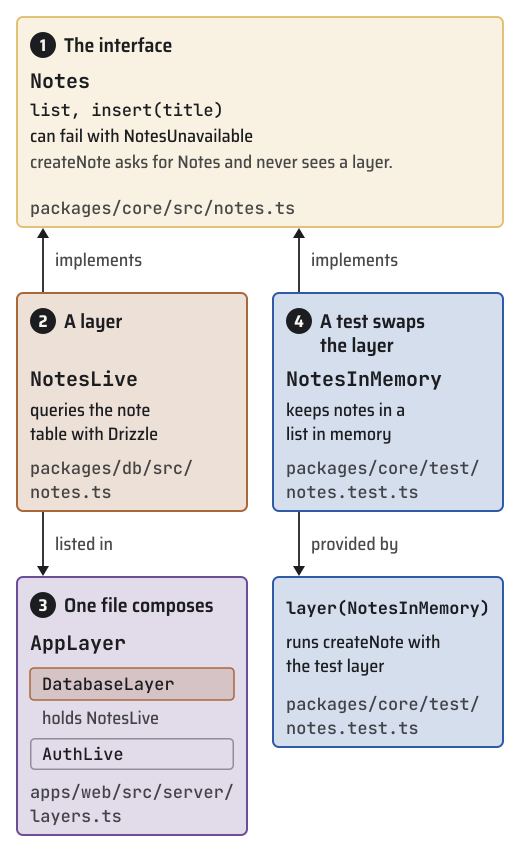

# Why your app is shaped like this

Every server capability in an efforge project (database, auth, email, storage, AI) is built from the same three pieces: an interface, a layer that implements it, and one line in one file that puts the layer in the app. A test swaps the layer for another. This page shows the pieces with email as the example, then the two places where Cloudflare and Effect meet, then the path of one request.

You need TypeScript and to have heard of Effect; each Effect term is defined where it first appears. The code comes from `npm create efforge my-app -- --yes --extras=email`, and `test/docs.test.ts` checks every sample against what efforge generates.

## The idea in one picture

<picture>
  <source media="(max-width: 600px) and (prefers-color-scheme: dark)" srcset="https://raw.githubusercontent.com/amagdy46/efforge/main/docs/assets/layers-narrow-dark.svg">
  <source media="(max-width: 600px)" srcset="https://raw.githubusercontent.com/amagdy46/efforge/main/docs/assets/layers-narrow-light.svg">
  <source media="(prefers-color-scheme: dark)" srcset="https://raw.githubusercontent.com/amagdy46/efforge/main/docs/assets/layers-dark.svg">
  
</picture>

The same facts as text:

1. **The interface.** `Mailer`, in `packages/core/src/mailer.ts`, has one method, `send(message)`, which can fail with `MailerError`. Your code asks for `Mailer` and never sees a layer.
2. **A layer.** `MailerLive`, in `apps/web/src/server/mailer.ts`, implements `Mailer` by sending through the `EMAIL` binding.
3. **One file composes.** `apps/web/src/server/layers.ts` lists `MailerLive` in `AppLayer`, next to `DatabaseLayer` and `AuthLive`.
4. **A test swaps the layer.** In `packages/core/test/mailer.test.ts`, `MailerTest` also implements `Mailer` and keeps messages in an array. `layer(MailerTest)` gives it to the test in place of `MailerLive`.

## 1. A capability is an interface

The email interface, from `packages/core/src/mailer.ts`:

<!-- sample: packages/core/src/mailer.ts -->
```ts
export class Mailer extends Context.Service<
  Mailer,
  { readonly send: (message: MailMessage) => Effect.Effect<void, MailerError> }
>()("@repo/core/Mailer") {}
```

An **Effect** is a description of work that has not run yet. When it runs, it succeeds with a value (here `void`) or fails with an error of the second type (here `MailerError`). Failures are part of the type, so the compiler knows how `send` can fail.

`Mailer` is a **service**: a named interface that code asks for instead of importing an implementation. Sending mail looks like this (from the [testing guide's example](examples/extras-email/mailer.test.ts)):

<!-- sample: repo:docs/examples/extras-email/mailer.test.ts -->
```ts
const sendWelcome = (to: string) =>
  Effect.gen(function* () {
    const mailer = yield* Mailer
    yield* mailer.send({ to, subject: "Welcome", text: "Thanks for signing up." })
    return "sent" as const
  }).pipe(Effect.catchTag("MailerError", () => Effect.succeed("not sent" as const)))
```

`Effect.gen` reads like `async` code, with `yield*` for `await`. `yield* Mailer` asks for the service.

`MailerError` is a **tagged error**: a class with a `_tag` field, so code can handle each kind of failure by name, as `Effect.catchTag("MailerError", ...)` does above.

Interfaces and their errors live in `packages/core`. It has no Cloudflare code, so it type-checks and tests anywhere.

## 2. A layer implements it

A **layer** builds a service. It may need other services, and it can fail while it builds. The smallest one in the email add-on, from `apps/web/src/server/mailer.ts`, prints each message instead of sending it:

<!-- sample: apps/web/src/server/mailer.ts -->
```ts
const ConsoleMailer = (from: string) =>
  Layer.succeed(
    Mailer,
    Mailer.of({
      send: (message) =>
        Effect.log(
          `[mail] from ${from} to ${message.to}\nSubject: ${message.subject}\n\n${message.text}`,
        ),
    }),
  )
```

`MailerLive`, in the same file, is the layer the app uses. With `MAIL_TRANSPORT=console` (set in `.dev.vars` for `pnpm dev`) it picks the layer above; otherwise it sends through Cloudflare Email Service, and fails with `MailerConfigError` when it is built if `MAIL_FROM` is missing.

Layers live in `apps/web/src/server`, next to the Cloudflare code they use.

## 3. One file composes the layers

`apps/web/src/server/layers.ts` is the only place layers are put together:

<!-- sample: apps/web/src/server/layers.ts -->
```ts
export const AppLayer = Layer.mergeAll(
  Logger.layer([Logger.consolePretty()]),
  DatabaseLayer.pipe(Layer.provide(WorkerEnvLive)),
  AuthLive,
  MailerLive,
  /* efforge:layers */
)
```

`AppLayer` provides every service the app has. `efforge add` adds layers before the `/* efforge:layers */` marker, so keep the `Layer.mergeAll(...)` shape. To change how a service works, change the layer listed here; code that asks for `Mailer` stays the same.

## 4. A test swaps one out

A **test layer** is another implementation of the same interface, made for tests:

<!-- sample: repo:docs/examples/extras-email/mailer.test.ts -->
```ts
const outbox: Array<MailMessage> = []
const MailerTest = Layer.succeed(
  Mailer,
  Mailer.of({ send: (message) => Effect.sync(() => outbox.push(message)) }),
)
```

The test runs `sendWelcome` with `MailerTest` instead of `MailerLive`, so it needs no Cloudflare and sends no mail. [Swap a layer to test](testing.md) has the whole test.

## Two seams that keep this working on Workers

### Only `cloudflare.ts` reads the Worker environment

A **binding** is how a Worker reaches a Cloudflare resource: the `HYPERDRIVE` database connection, an R2 bucket, the `EMAIL` sender. Cloudflare passes bindings in an object called `env`, and one file reads it:

<!-- sample: apps/web/src/server/cloudflare.ts -->
```ts
import { env } from "cloudflare:workers"
import { Layer } from "effect"
import { WorkerEnvironment } from "effect-cf"

/**
 * The Worker's `env` as effect-cf's `WorkerEnvironment`. This is the only place `env` is read;
 * everything else gets bindings through effect-cf layers (Hyperdrive, D1, KV, R2, ...) that
 * need `WorkerEnvironment`.
 */
export const WorkerEnvLive = Layer.succeed(WorkerEnvironment, env)
```

Bindings arrive with each request, but layers are built once and reused. Importing `env` from `cloudflare:workers` gives the bindings outside any request, so `WorkerEnvLive` is a plain layer, and every other layer gets its binding from it through [effect-cf](https://github.com/danieljvdm/effect-cf).

What this prevents: `cloudflare:workers` exists only inside workerd, Cloudflare's runtime, so a file that imports it cannot load under Vitest in Node. Because only `cloudflare.ts` imports it, the rest of the code loads in tests. Lint enforces the rule: importing `env` anywhere else fails `pnpm check` with "Read bindings through effect-cf layers; only server/cloudflare.ts reads env."

### One file runs your Effects: `runtime.ts`

A **runtime** runs Effects. It builds the layers an Effect needs, runs it, and closes what the layers opened. Server functions hand their Effects to `runtime.runPromise`, which returns a Promise.

Without Postgres (D1, or no database), `runtime.ts` is one `ManagedRuntime` per isolate. An **isolate** is one running copy of your Worker; it serves many requests. The runtime builds `AppLayer` on the first request and reuses it:

<!-- sample: repo:templates/base/files/web/src/server/runtime.ts -->
```ts
/** One runtime per Worker isolate; server functions run their Effects on it. */
export const runtime = ManagedRuntime.make(AppLayer)
```

With Postgres, it builds `AppLayer` for each call and closes it afterwards:

<!-- sample: apps/web/src/server/runtime.ts -->
```ts
/**
 * Server functions run their Effects through here. Workers must not reuse I/O (such as a
 * Postgres socket) across requests, so unlike a `ManagedRuntime` this builds `AppLayer` for each
 * call and closes it afterwards; Hyperdrive pools the connections behind it.
 */
export const runtime = {
  runPromise: <A, E>(effect: Effect.Effect<A, E, Layer.Success<typeof AppLayer>>): Promise<A> =>
    Effect.runPromise(Effect.provide(effect, AppLayer)),
}
```

What this prevents: a Worker may not use a socket that another request opened (Cloudflare fails it with "Cannot perform I/O on behalf of a different request"), and a handler whose Promise never settles fails with "The script will never generate a response". Because the runtime lives in one file, one place decides when layers are built and closed, for every handler.

Exception: `apps/web/src/server/invitation-email.ts` has its own runtime for `MailerLive`, because Better Auth calls it from inside the auth layer.

## How a request flows

The dashboard at `/app` lists notes. That request, from the browser to Postgres:

```text
GET /app
  route          apps/web/src/routes/app/index.tsx   loader calls listNotes()
  server fn      apps/web/src/server/notes.ts        runtime.runPromise(program)
  runtime        apps/web/src/server/runtime.ts      builds AppLayer for this call
  program        Effect.gen in notes.ts              yield* Database, then a query
  service        packages/core/src/Database.ts       the Database interface
  layer          packages/db/src/layer.ts            DatabaseLayer, a Drizzle client
  binding        apps/web/src/server/cloudflare.ts   WorkerEnvLive supplies HYPERDRIVE
  Postgres       through Hyperdrive
```

A **server function** is a TanStack Start function that runs on the server and can be called from a route or a component. This one is the middle of the list:

<!-- sample: apps/web/src/server/notes.ts -->
```ts
export const listNotes = createServerFn({ method: "GET" }).handler(() =>
  runtime.runPromise(
    Effect.gen(function* () {
      const { db } = yield* Database
      return yield* db.select().from(note).orderBy(desc(note.createdAt))
    }),
  ),
)
```

## What `efforge add` changes, and what it leaves alone

`efforge add extras/email` writes the add-on's own files (the interface and the layers) and makes small edits to the files that compose the app: `layers.ts`, the re-exports in `packages/core/src/index.ts`, the binding in `wrangler.jsonc` or `infra/alchemy.run.ts`, `.dev.vars`, `.env.example`, `AGENTS.md` and `efforge.jsonc`. [The email page](addons/extras-email.md) lists each edit.

It edits code with AST transforms (changes to the parsed code, not text replacement), so an edit touches only what it adds, and running it twice changes nothing. It never touches your routes, components, schema or the code that uses services. It refuses to replace a generated file you have edited unless you pass `--overwrite`, and it writes nothing if any step fails.

## Where to go next

- [Swap a layer to test](testing.md): test layers and the test rules.
- [Add-ons](addons/README.md): what each add-on adds and edits.
